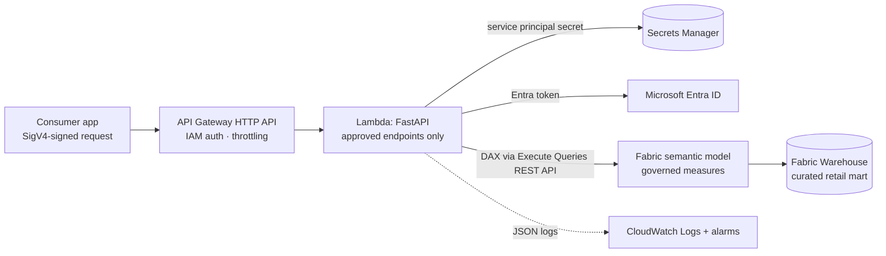

# Governed Semantic Model API on Fabric and AWS

[](https://github.com/gbadedata/governed-semantic-model-api/actions/workflows/ci.yml)


Downstream applications need trusted business metrics (revenue, orders, category sales), but
security policy does not let them query the warehouse or source systems. This API is the approved
path: it answers only from a governed Microsoft Fabric / Power BI **semantic model**, serves only a
fixed catalogue of measures through fixed endpoints, and runs on AWS Lambda behind an IAM-authorised
API Gateway.



## What it serves

| Endpoint | Returns |
|---|---|
| `GET /v1/metrics/revenue` | Total Revenue, Total Orders, Average Order Value for a date range |
| `GET /v1/metrics/sales-by-category` | Total Revenue by product category |
| `GET /v1/metrics/top-products` | products ranked by Total Revenue (`limit` 1-50) |
| `GET /v1/measures` | the governed measure catalogue and each definition |
| `GET /v1/health` | liveness; `?deep=true` also queries the semantic model |

Only `start_date`, `end_date` and (for top products) `limit` are accepted; anything else is rejected.
Full request and response shapes are in [docs/api_contract.md](docs/api_contract.md).

```bash
curl "http://127.0.0.1:8000/v1/metrics/revenue?start_date=2025-01-01&end_date=2025-03-31"
```
```json
{"period": {"start_date": "2025-01-01", "end_date": "2025-03-31"}, "currency": "USD",
 "total_revenue": 43430.95, "total_orders": 69, "average_order_value": 629.43,
 "source": "local-sample", "generated_at": "2026-11-07T19:36:23Z"}
```

## How governance is enforced

- **One definition of each metric.** The catalogue in `src/semantic_api/measures.py` names each measure
  and its definition; `semantic_model/measures.dax` implements the same measures in the model. Tests
  check that the two cover the same measures, and the local backend's figures are checked against an
  independent calculation from the raw sample data.
- **No raw-data path.** The Fabric backend only ever sends DAX that evaluates catalogued measures
  ([ADR 0003](docs/decisions/0003-governed-semantic-serving.md)). Consumers cannot send DAX, SQL or
  free-text filters, and the only values placed into a query are validated dates and a bounded integer.
- **Approved filters only.** Unknown query parameters return `400`; date ranges are capped at 366 days.

## Two interchangeable backends

| Backend | Used for | How it answers |
|---|---|---|
| `fabric` | production | DAX through the Power BI **Execute Queries** REST API ([ADR 0001](docs/decisions/0001-rest-over-xmla.md)), authenticated as an Entra service principal whose secret is read from AWS Secrets Manager |
| `local` | development and tests | the same measure definitions in SQL, run by DuckDB over the curated sample mart in `data/sample/` |

Both implement one small interface (`backends/base.py`), so the API code is identical either way.

## Status: what has and has not been verified

| Part | Status |
|---|---|
| API endpoints, validation, error envelope, request IDs, JSON logging | built and tested |
| Local backend figures | tested against an independent pandas calculation of the contract rules |
| Fabric backend: token flow and caching, Execute Queries call, result parsing, 401 refresh, 429 `Retry-After`, error mapping | built and tested against a **mocked** Power BI / Entra HTTP API |
| Lambda handler | tested by invoking it with an API Gateway HTTP API event; CI also builds the deployment package from `src/requirements.txt` alone and invokes it |
| SAM template | validated with `cfn-lint` (including the SAM transform) |
| DAX measures and queries | written to the model contract; **not yet run against a live Fabric semantic model** |
| End-to-end deployment to AWS | **not yet deployed**; steps in [docs/deployment_guide.md](docs/deployment_guide.md) |

The live checks are the next step: build the model, add `semantic_model/measures.dax`, confirm the
model returns the same figures as the local backend (43430.95 / 69 / 629.43 for the full sample), then
deploy.

## Run it locally

```bash
pip install -e ".[dev]"
python -m semantic_api        # local backend; interactive docs at http://127.0.0.1:8000/docs
python -m pytest              # 59 tests, no network or cloud account needed
cfn-lint infra/template.yaml
```

To point the local server at a real model, set the `SEMANTIC_API_FABRIC_*` variables from
`.env.example` and `SEMANTIC_API_BACKEND=fabric`.

## Repository layout

```
src/semantic_api/
  app.py               FastAPI app: routes, validation, error envelope, request logging
  measures.py          the governed measure catalogue and approved filters
  dax.py               DAX queries for each endpoint
  backends/base.py     backend interface, result types, errors
  backends/fabric.py   Execute Queries REST client with Entra auth
  backends/local.py    DuckDB over the sample mart
  secrets.py           credentials from Secrets Manager or environment
  lambda_handler.py    Lambda entry point (Mangum)
semantic_model/measures.dax   the measures to add to the semantic model
infra/template.yaml           SAM: HTTP API with IAM auth, Lambda, log group, alarms
data/sample/                  curated retail mart (synthetic) + data/dictionary
docs/                         API contract, architecture, model contract, ADRs, deployment, runbook, security
tests/                        59 tests
```

## Documentation

- [API contract](docs/api_contract.md) · [Architecture](docs/architecture.md) ·
  [Semantic model contract](docs/semantic_model_contract.md)
- [Deployment guide](docs/deployment_guide.md) · [Runbook](docs/runbook.md) · [Security](docs/security.md)
- Decisions: [REST over XMLA](docs/decisions/0001-rest-over-xmla.md) ·
  [AWS serverless hosting](docs/decisions/0002-aws-hosting-choice.md) ·
  [Semantic model as the only serving layer](docs/decisions/0003-governed-semantic-serving.md)

## Limitations

- The sample mart is small and synthetic (80 orders, Q1 2025); it exercises the logic, not scale.
- Currency is fixed to USD, as in the model contract.
- Execute Queries has per-user and per-query limits (for example on rows returned); the endpoints
  return aggregates well under them, but a future endpoint returning detail rows would need paging.
- Mangum (the Lambda adapter) relies on `asyncio.get_event_loop()`, so the function is pinned to
  the Python 3.12 runtime.
